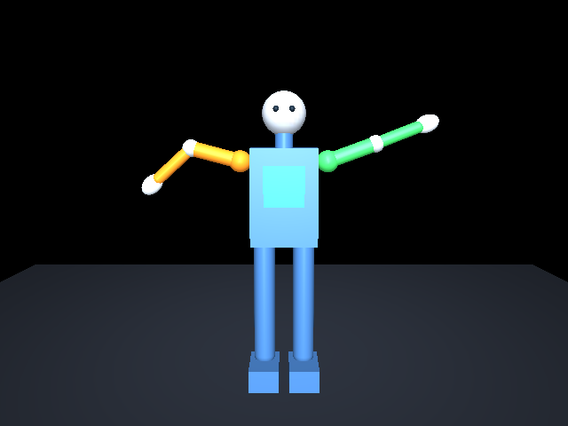

# Fase 2 — Humanoide MuJoCo e imitación frontal

La ampliación vigente es [Fase 2.1](PHASE2_1.md), con ocho ejes y seguimiento 3D
condicionado. Este documento conserva la evidencia histórica del modelo frontal;
sus medidas de cuatro ejes corresponden a la versión anterior.

Autorizada por el usuario el 23 de octubre de 2026. La Fase 1 está conservada;
no se implementan memoria, datos SQLite, aprendizaje, agentes ni refuerzo.

## Archivos de Fase 2

- `proyectorobot/simulation/assets/humanoid.xml`: geometría, bisagras y servos.
- `proyectorobot/control/retargeting.py`: calibración y conversión de coordenadas.
- `proyectorobot/control/motion.py`: filtro, límites y vigilancia de seguimiento.
- `proyectorobot/simulation/engine.py`: dinámica y guardas físicas.
- `proyectorobot/simulation/viewer.py`: ventana GLFW y render MuJoCo ligero.
- `proyectorobot/simulation/app.py` y `__main__.py`: demo, diagnóstico e imitación.
- `proyectorobot/vision/worker.py`: cámara, MediaPipe y GUI de cámara aislados.
- `tests/test_motion.py`, `test_retargeting.py`, `test_simulation.py`,
  `test_phase2_app.py` y `test_vision_worker.py`: pruebas de esta fase.
- `requirements-phase2.txt`: versiones previstas, sin instalación automática.
- `docs/phase2-demo.png`: imagen sintética del robot, sin webcam.

## Entorno comprobado

Fedora 43 x86_64, Python 3.12.15, MuJoCo 3.17.0, NumPy 2.5.4, MediaPipe 1.1.1
y OpenCV contrib 5.0.0.93 ya estaban disponibles. `pip check` pasó. No se
instalaron paquetes ni se cambiaron versiones. `requirements-phase2.txt` registra
las dependencias de las dos fases; una instalación futura requiere autorización.

La física se ejecuta en CPU. El visor fuerza `LIBGL_ALWAYS_SOFTWARE=1` en su
propio proceso para usar Mesa por software. Se comprobó render offscreen real:
**llvmpipe, LLVM 21.1.8**, proveedor Mesa, sin dispositivo GPU accesible.
Se limita llvmpipe a dos hilos (`LP_NUM_THREADS=2`) salvo configuración explícita.
No se usan CUDA, MuJoCo Warp/XLA, aprendizaje o servicios externos.

La biblioteca GLFW instalada declara soporte Wayland, no X11. OpenCV usa Qt5
y XWayland cuando `DISPLAY` está disponible; MuJoCo dibuja en una ventana GLFW.
Las pruebas autorizadas ya abrieron ambas ventanas y capturaron observaciones.
La imitación humana tras calibración sigue pendiente de confirmación por el usuario.
No se instalaron controladores gráficos ni se cambió GNOME.

## Ejecutar por etapas

Desde la raíz del repositorio, primero sin webcam:

```bash
.venv/bin/python -m proyectorobot.simulation --check
.venv/bin/python -m proyectorobot.simulation --demo --headless --duration 24
```

El segundo comando simula 24 segundos sin esperar tiempo real ni abrir
ventanas. Informa el recorrido medido de las ocho articulaciones y regresa
a reposo. La demo usa señales de prueba únicamente en este modo.

Para diagnosticar captura e IPC sin abrir ventanas (sí utiliza la webcam):

```bash
.venv/bin/python -m proyectorobot.simulation --check-camera --duration 8
```

Este diagnóstico no graba imágenes ni exige calibración. Informa número de
observaciones recibidas, inferencia y retardo.

Después, desde una terminal de GNOME:

```bash
.venv/bin/python -m proyectorobot.simulation --demo
```

Abre el humanoide durante 24 segundos, sin acceder a la webcam. Para verlo más
tiempo usar `--duration 30`. La rueda del ratón acerca/aleja y las flechas giran
la vista. `Q` o Escape cierran. La vista inicial es frontal:
izquierdo anatómico verde (derecha de la imagen), derecho naranja.

Cuando esa demo funcione, iniciar la imitación:

```bash
.venv/bin/python -m proyectorobot.simulation --camera 0
```

Se abren cámara y humanoide simultáneamente. Se pueden colocar lado a lado con
GNOME. Las opciones de resolución y espejo son independientes de la simulación:

```bash
.venv/bin/python -m proyectorobot.simulation --no-mirror
.venv/bin/python -m proyectorobot.simulation --width 480 --height 360 --fps 15
.venv/bin/python -m proyectorobot.simulation --window-width 960 --window-height 600
```

La Fase 1 continúa usando `.venv/bin/python -m proyectorobot`.

## Calibración y movimientos

1. Colocarse de frente, con ambos hombros, codos y muñecas visibles. No es
   necesario encuadrar las caderas ni las piernas.
2. Mantener brazos abajo, codos estirados y postura cómoda, sin mover la cámara.
3. Esperar al menos un segundo y seis muestras estables. El panel muestra el
   progreso; exige hombros a menos de 35° del reposo, codos a menos de 25° y
   variación menor de 8° respecto de la primera muestra de esa calibración.
4. Levantar, bajar y doblar ambos brazos. Las consignas proceden de sus ángulos
   medidos continuamente. Las señales de demo no intervienen en la imitación.
5. Pulsar `C` en cualquiera de las ventanas para recalibrar; el robot vuelve
   suavemente a neutral mientras se recoge una calibración nueva.

La geometría usa los índices de pose de MediaPipe 11/12 (hombros), 13/14 (codos),
15/16 (muñecas). Se convierten las coordenadas normalizadas a
píxeles usando ancho y alto reales antes de calcular ángulos; así no se deforma
el resultado cuando la relación de aspecto no es cuadrada.

El eje lateral sigue la línea de hombros, orientada hacia el hombro izquierdo
anatómico. Su perpendicular hacia abajo define el eje vertical. La separación
entre hombros fija la escala. Así se trabaja con el torso superior sin inventar
posiciones de caderas fuera de imagen. Para cada lado:

- Elevación de hombro: `atan2(componente hacia fuera, componente hacia abajo)`
  del segmento hombro → codo.
- Flexión firmada: diferencia angular envuelta entre codo → muñeca y hombro → codo.
- Se resta el ángulo de calibración y se añade la postura neutral del robot.

El espejo se aplica únicamente al video y al dibujo. No se intercambian las
articulaciones por cambiar `--mirror`; que los lados ocupen columnas diferentes
en la cámara en espejo y en el robot frontal es normal.

## Modelo y controlador

`proyectorobot/simulation/assets/humanoid.xml` contiene geometrías primitivas:
cabeza, ojos, cuello, torso, piernas/pies fijos, hombros, brazos, codos y manos.
El torso está anclado al mundo: no hay caída, equilibrio dinámico ni locomoción.
En la versión inicial, cada brazo tenía dos bisagras coplanares y dos servos.
Fase 2.1 sustituye esos ejes por tres de hombro y uno de codo; los rangos de la
tabla siguiente describen exclusivamente el modelo anterior:

| Articulación | Rango físico | Neutral |
| --- | --- | --- |
| Hombro izquierdo/derecho | -30° a 170° | 10° hacia fuera |
| Codo izquierdo/derecho | -150° a 150° | 0° |

El signo del codo indica el sentido de flexión **proyectado en el plano frontal**.
Es un mecanismo simplificado bidireccional, no un modelo biomecánico de codo
humano ni una estimación de rotación del húmero. Las manos no tienen dedos ni
articulaciones propias. No hay autocolisiones o contacto de brazos con torso.

La física usa `implicitfast`, paso de 5 ms (200 Hz), gravedad y compensación de
gravedad en los cuerpos móviles. Los servos tienen fuerza limitada, ganancias
PD y margen de 2° respecto al límite al generar consignas. El controlador aplica
un filtro exponencial de 80 ms en la aplicación y limita las consignas a 1.5 rad/s. Las guardas
del motor limitan posiciones y desplazamiento/velocidad física a 2 rad/s después
de cada paso: MuJoCo tiene restricciones blandas y el límite XML por sí solo no
constituye una cota dura. Estas proyecciones se cuentan en `guard_count`; el
modelo no pretende ofrecer dinámica biomecánica rigurosa.

El ciclo principal intenta 60 Hz y sincroniza el visor a unos 20 Hz. La captura
se limita a los FPS solicitados, por defecto 15. Tras una pausa se simula como
máximo 100 ms por iteración para evitar una recuperación costosa y brusca. Los
200 Hz son el paso configurado, no una garantía de tiempo real en cualquier carga.
El visor ligero utiliza `mjv_updateScene` y `mjr_render`, no el ciclo del visor
estándar `simulate`: dibuja internamente a 480×360, sin sombras, y escala la
imagen a la ventana conservando proporciones. Esto limita el coste al maximizar
la ventana o usar escalado HiDPI. No se ofrecen los menús de edición de `simulate`.

## Pérdida de seguimiento y errores

Las observaciones se aceptan con presencia y visibilidad >=0.6, coordenadas
finitas y puntos dentro de la imagen. Un segmento casi colapsado o muy acortado
respecto de calibración se descarta, igual que un torso degenerado o una anchura
de hombros muy reducida. Esto evita inventar ángulos al girarse de perfil o
apuntar hacia la cámara, pero no elimina todas las ambigüedades monoculares.

Cada brazo sin puntos fiables deja de seguir inmediatamente y vuelve a neutral
de manera filtrada. El otro puede continuar si el torso y sus puntos son fiables.
Al reaparecer, se exigen 150 ms estables antes de reactivar ese brazo.

La webcam, MediaPipe, calibración y la ventana OpenCV se ejecutan en un proceso
`spawn`. El principal conserva la física, el visor MuJoCo y la vigilancia.
Separar Qt de GLFW y acotar el render corrigió una entrega muy escasa de
observaciones que se encontró durante las primeras pruebas gráficas.

La cola IPC de tamaño **uno** transporta observaciones, ángulos, estados y tiempos;
no transporta imágenes. El video permanece en el proceso de visión y se descartan
resultados antiguos. Si la lectura o inferencia se bloquean,
no se siguen aplicando consignas indefinidamente: tras 350 ms desde la captura
del último frame, el controlador retorna a reposo incluso sin mensajes nuevos.
Se exige esa frescura también al recibir frames retrasados. Los timestamps son
monotónicos; el retardo mostrado incluye inferencia y entrega al consumidor,
pero no mide el retardo interno del dispositivo de cámara.

La recepción IPC tiene un hilo dedicado y una segunda cola local de tamaño uno:
el ciclo de control nunca lee ni deserializa directamente una tubería.
Así, un mensaje incompleto por caída del productor tampoco bloquea la vigilancia.
Las dos colas conservan como máximo dos observaciones. Una generación de
calibración descarta consignas anteriores a `C`, incluso si llegaron retrasadas.

`--tracking-timeout 0.5` permite ajustar el umbral tras medir el equipo; ampliarlo
también retrasa la reacción ante fallos. Antes de hacerlo, reducir resolución y
cerrar otras aplicaciones. No se promete precisión ni FPS sin prueba con personas.

Si falla captura/inferencia, se muestra el error, se activa reposo y se dejan
2.5 segundos de retorno antes de cerrar con código 1. La inicialización de visión
tiene un límite de 15 segundos. `Q`, Escape, cierre de cualquiera de las ventanas
o Ctrl+C cierran los recursos; Ctrl+C devuelve 130. El cierre del proceso espera
dos segundos y, si está bloqueado, termina únicamente ese proceso propietario de
la webcam. Nunca se graba ni se transmite video. No se guardan calibraciones.

## Perfil compacto y menor retardo

La cámara de Fase 2 abre a 640×480 con texto compacto debajo del video; se eliminó
la barra lateral grande. Se procesa una imagen de como máximo 480×360, sin
deformarla ni ampliarla. La captura se negocia conservando la relación de aspecto
(640×480 para el perfil predeterminado), porque solicitar directamente 480×360
en esta webcam devolvía 640×360 y cambiaba el encuadre vertical. El tamaño real
de captura se informa en terminal.

Para mover brazos bastan Pose Landmarker y sus muñecas. Hand Landmarker no se
crea ni ejecuta en el perfil predeterminado; `--hands` restaura sus puntos de
dedos con mayor consumo de CPU. La Fase 1 conserva ambos detectores y su interfaz.

La calibración y los estados del panel usan hombros como referencia, por lo que
ya no muestran pérdida de seguimiento solo por no ver las caderas. Se conservan
visibilidad/presencia, límites articulares, velocidad y vigilancia de 350 ms.
`CALIBRAR: BRAZOS ABAJO` significa que debes bajar y estirar los brazos, no que
la aplicación esté congelada. Espera a `SIGUIENDO`; `C` reinicia la calibración.

En una prueba de 12 segundos del perfil reducido: 75 observaciones recibidas,
74 consumidas, ~10 FPS de visión tras iniciar, última inferencia 63 ms, retardo
143 ms y ciclo de simulación 42.4 FPS. La postura observada no completó la
calibración; el estado final fue `CALIBRAR: BRAZOS ABAJO`. El objetivo de 15 FPS
sigue sin acreditarse; la mejora de retardo no garantiza reconocimiento sin
encuadrar los brazos y completar esa calibración.

Al dejar abierta la versión con captura 640×480 renegociada y procesamiento
480×360, la terminal registró ~11–13 FPS y 56–71 ms de inferencia tras iniciar.
La ventana de gestos quedó abierta para la comprobación del usuario; esto no
se presenta como validación automática de la calibración humana.

## Pruebas y evidencia

```bash
.venv/bin/python -m unittest discover -s tests -v
```

Se prueban calibración, escala/inclinación/aspecto, ángulos conocidos, lateralidad,
flexión, oclusiones, recuperación, calibración inválida, consignas fuera de rango,
velocidades, vigilancia de visión bloqueada, estabilidad física y movimiento de
muñecas reales de MuJoCo a partir de coordenadas sintéticas. También errores de
un proceso de visión real con modelos ausentes y cierre de las ventanas simulado.
Estas pruebas nunca abren una webcam ni una ventana real.

La suite completa del perfil compacto pasó **79 pruebas sin omisiones**.
Incluye transferencia entre procesos sin imágenes, descarte de consignas de una
calibración anterior, cierre de cámara simulado y vigilancia con recepción IPC
bloqueada. Sintaxis Python 3.12, TOML, XML y enlaces locales también comprobados.

Se ejecutó primero la etapa física y después la integración. En ocho segundos de
demo headless, antes de conectar visión, los recorridos medidos de articulaciones
fueron aproximadamente 118.8°, 156.9°, 97.9° y 156.5°; se volvió a 10°,0°,10°,0°.
El render sintético frontal fue inspeccionado visualmente y confirmó cabeza,
torso, piernas, manos y ambos brazos con sus articulaciones.
También se ejecutó la demo **interactiva** autorizada durante cinco segundos en
GNOME, sin webcam: el visor abrió, movió las cuatro articulaciones y terminó
con código 0 y postura segura. Esto todavía no valida la imitación con una persona.

Como referencia exclusivamente headless, ocho segundos de demo más retorno
seguro consumieron 1.82 s de pared y 56 024 KiB de RSS máximo (~55 MiB), medidos
con `/usr/bin/time`. No incluye ventanas ni MediaPipe y no representa el consumo
completo de la imitación.

Antes del perfil compacto, una prueba con ambas ventanas duró 15 segundos: 58 observaciones
recibidas por IPC y 57 consumidas; última inferencia 114 ms, retardo 258 ms y
ciclo de simulación 38.3 FPS. Visión registró aproximadamente 5–6.5 FPS tras
inicialización, por debajo del objetivo orientativo de 15 FPS. No se completó
la calibración en esa prueba (cero frames con control activo): no se presenta
como demostración de imitación humana. El movimiento desde coordenadas hasta
las muñecas del modelo sí está cubierto con poses sintéticas en las pruebas.



Para generar opcionalmente una imagen **solo del robot**, sin webcam, en un
equipo con Mesa/EGL disponible:

```bash
MUJOCO_GL=egl PYOPENGL_PLATFORM=egl LIBGL_ALWAYS_SOFTWARE=1 \
  .venv/bin/python -m proyectorobot.simulation --demo --headless --duration 3 \
  --snapshot /tmp/proyectorobot-demo.png
```

`--headless` sin `--snapshot` no necesita contexto OpenGL. Un snapshot sí lo
necesita y puede fallar si no existe un backend EGL/OSMesa adecuado. Este proyecto
no instala bibliotecas del sistema para resolverlo sin autorización.

El visor ligero definitivo también completó una demo gráfica de tres segundos
después del último ajuste: las cuatro articulaciones recorrieron aproximadamente
100.7°, 83.2°, 97.7° y 78.2°, y terminaron en reposo con código 0.

En las pruebas reales aparecieron avisos de Qt sobre su directorio de fuentes
y de MediaPipe sobre feedback/ROI. No impidieron abrir las ventanas ni recibir
observaciones; las letras del panel se dibujan con OpenCV. No se ocultaron avisos
ni se instalaron fuentes o paquetes para corregirlos automáticamente.

## Repintado al mover y redimensionar la ventana

El usuario confirmó elevación/bajada de brazos y aportó una foto con estelas del
robot y del texto, además de contenido de otras ventanas visible dentro del visor.
No era simplemente el retardo de seguimiento: la prueba gráfica reprodujo
transparencia y presentación con el framebuffer offscreen todavía activo.

El visor ahora solicita una superficie opaca con doble búfer, limpia por completo
color y profundidad antes de copiar el frame y fuerza alfa opaco tras la copia.
Restaura el framebuffer de ventana antes de presentar. Los eventos de exposición
y cambio de tamaño repintan el estado más reciente sin avanzar la física ni
consumir nuevas observaciones; se evita el repintado recursivo.

Prueba gráfica manual automatizada, sin webcam ni capturas:

```bash
.venv/bin/python -m scripts.check_robot_repaint
```

Abre únicamente el robot, cambia entre tres tamaños y comprueba los píxeles antes
de presentar. Colorea temporalmente el búfer anterior con un color de prueba para
detectar zonas sin repintar, comprueba opacidad y framebuffer activo. La versión
anterior falló; la corregida pasó 22 presentaciones, incluyendo las provocadas por
eventos de repintado. No instala paquetes ni guarda imágenes.

La suite completa pasó **83 pruebas sin omisiones**. Incorpora regresiones sin GUI para limpiar/presentar, exposición,
minimización y prevención de recursión. Queda por confirmar visualmente, desde
GNOME, que arrastrar y superponer ventanas ya no reproduce las estelas de la foto.
La corrección gráfica original no añadía articulaciones ni inferencia 3D.
Fase 2.1 incorpora esos movimientos de forma condicionada a la calidad del seguimiento.

Referencias: [repintado y transparencia de GLFW](https://www.glfw.org/docs/latest/window_guide.html#window_refresh),
[operaciones de framebuffer MuJoCo](https://github.com/google-deepmind/mujoco/blob/main/src/render/classic/render_gl2.c).

## Verificación manual pendiente

El usuario confirmó la webcam y reconocimiento básico de Fase 1. En el entorno
restringido del agente no están expuestos `/dev/video*` ni `/dev/dri`; esto no
indica un fallo del equipo. Las ejecuciones autorizadas fuera de ese entorno sí
abrieron cámara y ambas ventanas. La inferencia sintética, física y esas pruebas
breves no sustituyen estas comprobaciones desde la terminal GNOME del usuario:

- Confirmar visualmente la demo en la pantalla del usuario; su ejecución
  interactiva automática ya terminó correctamente.
- Ver simultáneamente cámara y robot; terminar calibración sin movimiento brusco.
- Elevar/bajar izquierdo, derecho y ambos; doblar codos en varias posiciones.
- Repetir con y sin espejo: conservar lados anatómicos y alineación de esqueleto.
- Ocultar un brazo o torso, salir del encuadre y volver: reposo y recuperación.
- Recalibrar con `C`; cerrar por ambas ventanas, Q/Escape y Ctrl+C; reabrir webcam.
- Medir durante dos minutos FPS de visión/simulación, retardo y CPU/RAM. El
  objetivo inicial de visión es 15 FPS a 640×480; comparar 480×360 si es necesario.
- Confirmar legibilidad y coexistencia Qt/XWayland y GLFW/Wayland. Ante un error
  gráfico, guardar el mensaje de terminal y diagnosticar antes de cambiar paquetes.

Persisten las verificaciones de robustez/cierre/rendimiento y espejo de Fase 1
que no fueron confirmadas explícitamente; ver `VALIDATION.md`. No iniciar Fase 3.

Fuentes primarias: [visualización MuJoCo](https://mujoco.readthedocs.io/en/stable/programming/visualization.html),
[MJCF y servos de posición](https://mujoco.readthedocs.io/en/stable/XMLreference.html#actuator-position).
